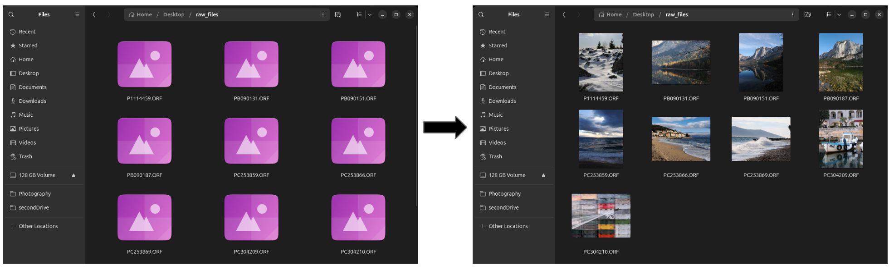

# Nautilus Thumbnailer for RAW Previews 

A lightweight and fast thumbnailer for Nautilus that generates thumbnails for RAW image files using embedded previews extracted with exiv2.
This thumbnailer should work with most RAW formats that have embedded previews.

The script now also downscales the thumbnail to the size requested by the thumbnail
cache (via the standard freedesktop.org `%s` placeholder) instead of writing the
full-resolution embedded preview straight into `~/.cache/thumbnails` — see
[Installation](#installation). There's also an optional [Sushi (Quick Look)
plugin](#sushi-quick-look-full-preview) so pressing Space on a RAW file shows an
actual full-resolution preview.

Tested on Ubuntu 24.04, Ubuntu 26.04, and Fedora with Nautilus. Should work also with  Nemo and Caja.

<picture style="align: center; padding-bottom: 3mm;">
  
</picture>

##  Installation

```bash
# close the repo and move to the folder containing the scripts
git clone https://github.com/emuskardin/nautilus-raw-thumbnails.git
cd nautilus-raw-thumbnails

# install dependencies
# For Debian/Ubuntu
sudo apt install exiv2 imagemagick libimage-exiftool-perl
# For Fedora
# sudo dnf install exiv2 ImageMagick perl-Image-ExifTool

# Move the thumbnailer configuration to the system directory
sudo cp exiv2raw.thumbnailer /usr/share/thumbnailers/

# Move the thumbnailer script to the bin directory and make it executable
sudo cp exiv2-thumbnailer.sh /usr/local/bin/
sudo chmod +x /usr/local/bin/exiv2-thumbnailer.sh

# Restart Nautilus to apply the changes:
nautilus -q

# Optional (force thumbnail generation)
rm -rf ~/.cache/thumbnails/*
```

## Sushi (Quick Look) full preview

Pressing Space on a file in Nautilus normally opens [GNOME
Sushi](https://gitlab.gnome.org/GNOME/sushi) for a quick full-size preview. Sushi's
own image viewer relies on gdk-pixbuf, which has no RAW support, so without this
plugin RAW files just show a generic icon there (the grid thumbnailer above only
covers the grid view, not Sushi).

`sushi/raw.js` is a Sushi plugin that reuses `exiv2-thumbnailer.sh` (called without
the size argument, so it gets the full-resolution preview) to show a real preview
when you hit Space on a RAW file.

```bash
mkdir -p ~/.local/share/sushi/viewers
cp sushi/raw.js ~/.local/share/sushi/viewers/
```

No restart needed, Sushi is D-Bus-activated and picks it up on next launch.

**Compatibility:** only tested against **gnome-sushi 50.x**, which uses the legacy
GTK3/GJS `imports`-based plugin system (`~/.local/share/sushi/viewers/*.js`). Newer
Sushi versions (≥51) are being rewritten to GTK4/Adwaita/Glycin with a different
plugin API (`~/.local/share/sushi/plugins-1/`) — `sushi/raw.js` won't load there as-is
and would need porting. Check your version with `dpkg -l gnome-sushi` /
`gnome-sushi --version` first.

`sushi/raw.js` is derived from Sushi's own source and is licensed
GPL-2.0-or-later (see `sushi/LICENSE`), unlike the rest of this repo (MIT).

## Troubleshooting

If thumbnails are not generated, check that mime type of your RAW files is contained in exiv2raw.thumbnailer.

If you have already tried this solution (that does not work on Ubuntu 20 and 24) where you [add mime types to gdk-pixbuf-thumbnailer.thumbnailer](https://askubuntu.com/questions/283072/nautilus-isnt-displaying-thumbnails-for-my-nef-files-photo-raw) (second answer), you might want to remove them from there. I am not sure if this will cause issues with order of thumbnailsers. 

If you're having issues with the thumbnailer, try these debugging steps:

1. Reset Nautilus and clear the thumbnail cache:
```bash
nautilus -q
rm -rf ~/.cache/thumbnails/*
```

2. Launch Nautilus with debugging enabled:
```bash
G_MESSAGES_DEBUG=all NAUTILUS_DEBUG=Window nautilus
```

3. Check if the script can extract thumbnails manually:
```bash
/usr/local/bin/exiv2-thumbnailer.sh /path/to/your/file.RAW /tmp/test-thumbnail.png
```

4. Verify that your RAW files have embedded previews:
```bash
exiv2 -pp /path/to/your/file.RAW
```

#### Tested Formats

Working
- .ORF, .ARW, .NEF, .RAF, .CR2, .CR3, DNG, .RW2

WIP
- 
